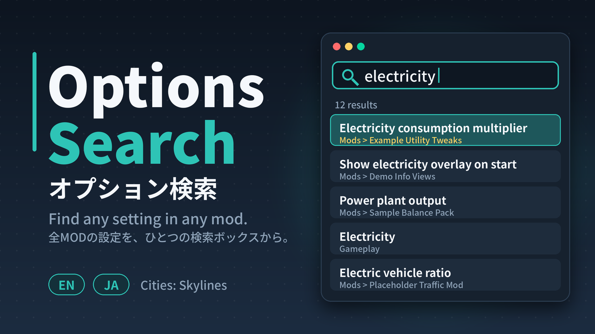

# Options Search — Cities: Skylines 1 mod

[日本語](#日本語) | [English](#english)



---

## English

Adds a search box to the Options screen that searches the base game's and every mod's settings at once.

### Features
- One search across labels, buttons, tooltips and dropdown choices (base game + all mods)
- Also matches mod / category names, so it works as a mod list search
- Multi-word AND search (`traffic lights`)
- Click a result (or press Enter for the first one) to jump to the right category / mod page; the setting blinks
- The index is rebuilt every time Options is opened
- English / Japanese UI (Auto / English / 日本語 in the mod's settings)

### Usage
1. Esc → Options
2. Type in the search box at the top left (Ctrl+F also focuses it)
3. Mouse wheel scrolls the results, click to jump, Esc clears the search

### Build
Requires the .NET SDK. Game assemblies are **not** included; they are referenced from your own installation.

```
dotnet build -c Release -p:CSLManaged="C:\Program Files (x86)\Steam\steamapps\common\Cities_Skylines\Cities_Data\Managed"
```

On Windows the DLL is copied to `%LOCALAPPDATA%\Colossal Order\Cities_Skylines\Addons\Mods\OptionsSearch` after the build (override with `-p:ModDir=...`).

### Source layout
| File | Role |
|---|---|
| `Mod.cs` | `IUserMod`, the mod's own settings |
| `OptionsSearchHost.cs` | Watches `OptionsPanel`, attaches the UI, rebuilds the index |
| `OptionsIndex.cs` | Walks the UI tree, collects entries and tab hierarchy, search / scoring |
| `SearchUI.cs` | Search box and result list (position constants at the top) |
| `Jumper.cs` | Tab switching → scrolling → blinking |
| `Str.cs` | English / Japanese strings |
| `workshop/` | Workshop description (BBCode), thumbnail and its generator script |

### Status
Experimental. UI layout and the way mod settings are discovered depend on the game's internal UI structure, so issues may remain. Bug reports and pull requests are welcome.

### License
[MIT](LICENSE)

---

## 日本語

オプション画面に検索ボックスを追加し、ゲーム本体と全MODの設定項目を横断検索するMODです。

### 機能
- ラベル・ボタン・ツールチップ・ドロップダウンの選択肢を一括検索 (ゲーム本体 + 全MOD)
- MOD名・カテゴリ名でも検索可能 (MODリストの検索にも使えます)
- スペース区切りのAND検索 (`traffic lights`)
- 結果をクリック (Enterで先頭) すると該当のカテゴリ/MODページへ移動し、項目が点滅
- オプションを開くたびに索引を再構築
- 英語/日本語UI (MOD設定で 自動・English・日本語 を選択)

### 使い方
1. Esc → オプション
2. 左上の検索ボックスに入力 (Ctrl+Fでもフォーカス)
3. マウスホイールで結果をスクロール、クリックで移動、Escで入力クリア

### ビルド
.NET SDK が必要です。ゲームのDLLは**同梱していません**。お手元のゲームを参照します。

```
dotnet build -c Release -p:CSLManaged="C:\Program Files (x86)\Steam\steamapps\common\Cities_Skylines\Cities_Data\Managed"
```

Windowsでは、ビルド後に `%LOCALAPPDATA%\Colossal Order\Cities_Skylines\Addons\Mods\OptionsSearch` へ自動コピーされます (`-p:ModDir=...` で変更可)。

### 構成
上の「Source layout」の表を参照してください。

### 状況
実験的なMODです。UIの配置やMOD設定の検出方法はゲーム内部のUI構造に依存するため、不具合が残っている可能性があります。バグ報告・プルリクエスト歓迎です。

### ライセンス
[MIT](LICENSE)
